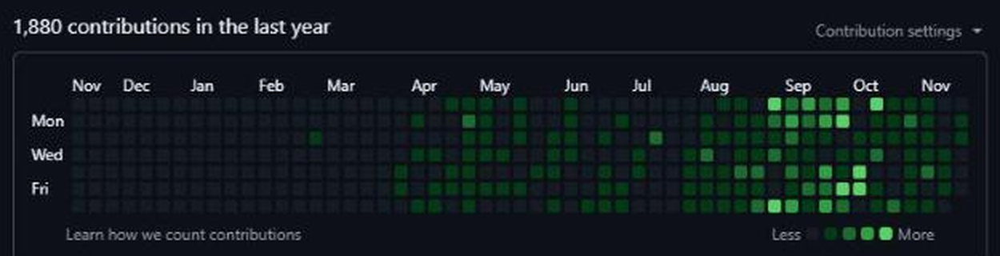

# Grown Online - Bachelor's final project (2017)

Map-based Android application that puts businesses of any size on one platform and lets customers find, compare and contact them by location, requirement and rating.

- **Authors:** Ali Munir and Sobia Zaheer (group project)
- **Supervisor:** Mr. Kamran Habib Khan
- **Institution:** Department of Information Technology, University of Haripur, Pakistan
- **Degree:** B.Sc. Computer Science, September 2017
- **Module:** Senior Project Design I and II (3 + 3 credit hours, two semesters)

## Individual contribution
- **Ali Munir:** software development (writing the code of the Android application).
- **Sobia Zaheer:** helped with preparing the project documentation (the written report).

## Source code
The source code of this 2017 project is **no longer available** to the author. The implementation is documented in the thesis report. For current examples of the author's software work, see the GitHub profile https://github.com/MuhammadAliMunir and the contribution graph below (many of the author's projects are in private repositories).

## Files
| File | Content |
|---|---|
| `Grown_Online_Bachelor_Thesis_2017.pdf` | The full Bachelor's thesis (English) |
| `Thesis_Supplement_Research_Question_Method_Evaluation.pdf` | Two-page supplement written in October 2026 by Ali Munir: research question, method, evaluation and limitations, using only content from the thesis |
| `HEC_Curriculum_BS_Computer_Science_2017.pdf` | Official Higher Education Commission (Pakistan) national curriculum for BS Computer Science (module descriptions) |
| `GitHub_contribution_graph_Nov2026.png` | Screenshot of the author's GitHub contribution graph (1,880 contributions in the last year, as shown on the profile in Nov 2026) |

## Summary
**Problem.** Small and medium businesses in Pakistan often cannot afford their own mobile application, and customers cannot install a separate application for every shop or service provider.

**Approach.** Two user roles: businesses and service providers create a profile (location, timings, products and services, offers) from a free template; customers search by location and requirement, compare providers by ratings and feedback, view them on a map and contact them by live chat. Accounts are verified (including an ID image) to reduce fake profiles.

**Method.** Review of existing applications in five categories; comparison of development environments (Xamarin, Eclipse, Android Studio) and databases (SQLite, MongoDB, Firebase). Android Studio and Firebase (real-time data, authentication, cloud messaging) were chosen.

**Result.** A working Android application (Android 5.0 and above) with sign-up by e-mail or social login, business profiles, map location, look-around search, ratings and feedback, and live chat. The report contains no quantitative evaluation; limitations and future work are discussed in the conclusion.

## Author
Ali Munir - software and AI engineer (about 9 years). Applicant, M.Sc. Artificial Intelligence Engineering, University of Passau, summer semester 2027.

